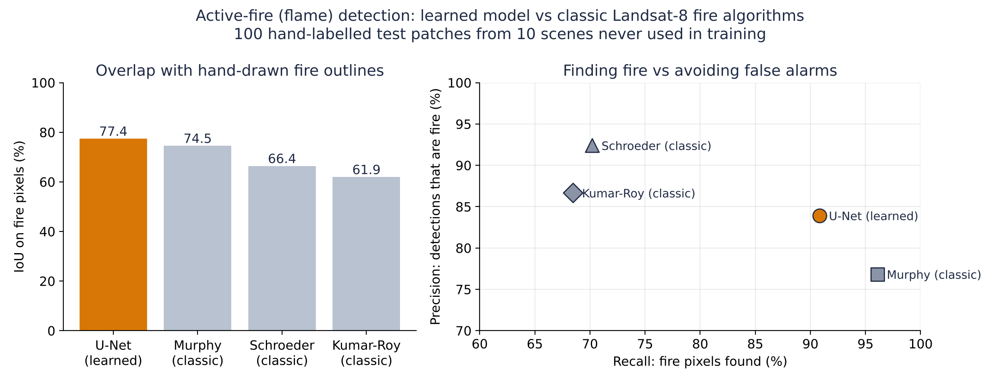
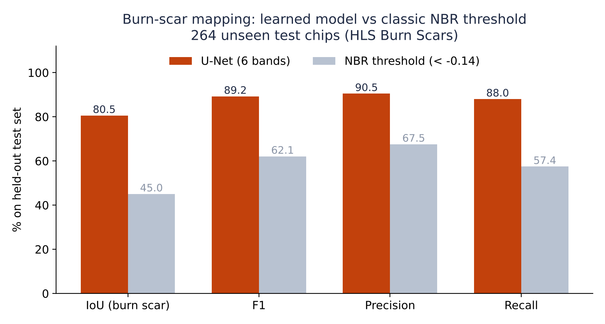
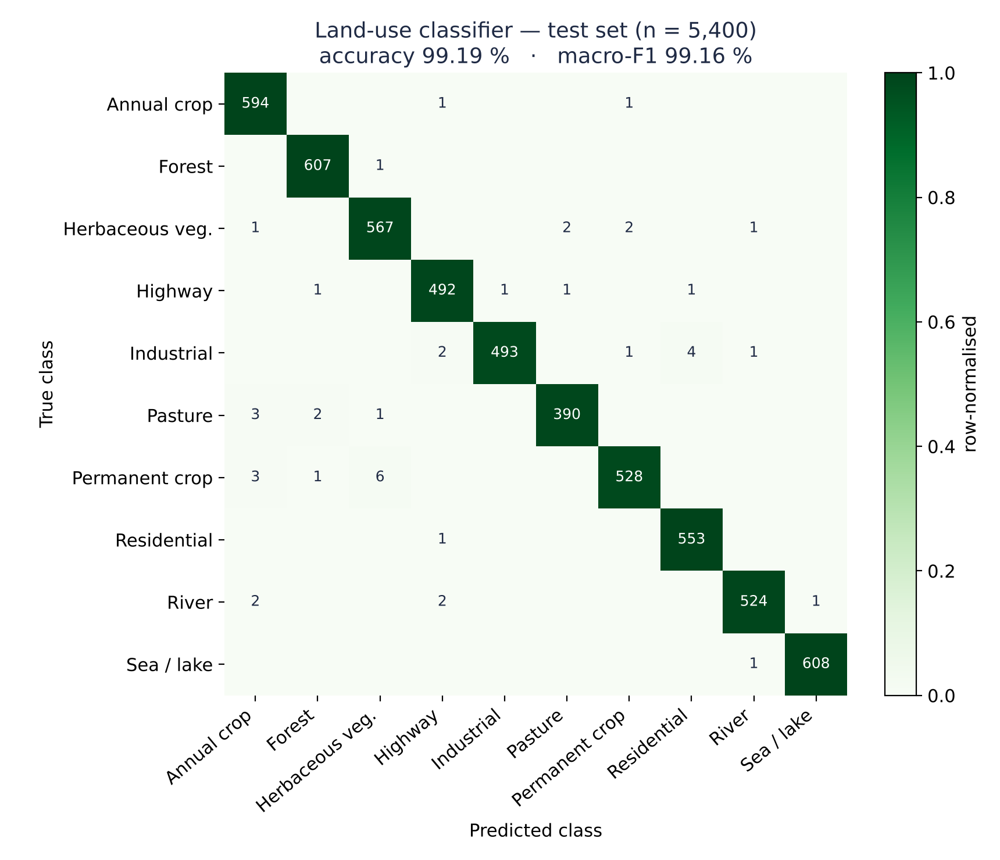

# GSTP Hazard Models — trained AI models for the CRISP monitoring sites

**Space Systems Ltd · ESA GSTP onboard Earth-observation demonstrator — AI/ML workstream**
Author: Inayat Arshad, AI/ML Engineer

This repository trains, evaluates and applies one AI model for each of the five hazard modules of
**CRISP** (Climate Resilience Intelligence Satellite Platform): **floods, wildfires, forestry,
agriculture and air quality**. The models are trained on public, expert-labelled satellite datasets,
tested on held-out data, compared with the spectral-index threshold rules CRISP uses today, and then
applied to the **60 CRISP monitoring sites** (20 in Spain, 16 in the UK, 24 worldwide).

This is the training stage only. Every image model is also exported to ONNX — the hand-off format for
the later TensorRT / Jetson deployment step — but no on-board deployment is claimed here.

---

## Results at a glance

All numbers are on held-out test data the model never saw; thresholds were chosen on validation data.
Full tables: [`results/RESULTS.md`](results/RESULTS.md) · Report: [`docs/GSTP_Hazard_Models_Technical_Report.docx`](docs/GSTP_Hazard_Models_Technical_Report.docx)

| Module | Task | Model | Test result | Classic index baseline | Status |
|---|---|---|---|---|---|
| Agriculture | Land-use classification (10 classes) | ResNet-18, Sentinel-2 pretrained (SSL4EO-S12) | **99.19 % accuracy**, macro-F1 99.16 % (5,400 images) | — | ✅ Done |
| Wildfires — flames | Active-fire segmentation | U-Net / ResNet-34, SWIR-2 · SWIR-1 · Blue | **IoU 0.774**, F1 0.872 (100 hand-labelled patches, 10 unseen scenes) | Best classic algorithm (Murphy): IoU 0.745 · Schroeder 0.664 · Kumar-Roy 0.619 | ✅ Done |
| Wildfires — burn scars (after the fire) | Burn-scar segmentation | U-Net / ResNet-34, 6 bands | **IoU 0.805**, F1 0.892 (264 chips) | NBR threshold: IoU 0.450, F1 0.621 | ✅ Done |
| Floods | Water segmentation (radar / optical / both) | U-Net / ResNet-34 | **IoU 0.838** radar+optical (90 chips); optical 0.798 on the unseen Bolivia event | MNDWI: 0.773 · radar VV threshold: 0.463 | ✅ Done |
| Forestry | Forest segmentation → forest loss | U-Net / ResNet-34, R-G-B-NIR | **IoU 0.929**, F1 0.963 (200 images; Amazon 0.957, Atlantic 0.887) | NDVI threshold: IoU 0.738, F1 0.849 | ✅ Done |
| Air quality | Next-day NO₂ and PM2.5 forecast, 60 sites | LightGBM | **NO₂ MAE 2.01 µg/m³** (39 % lower error than persistence, better at all 60 sites); PM2.5 MAE 3.95 (18 % lower) | Persistence: NO₂ 3.31, PM2.5 4.82 | ✅ Done |

<p align="center">
  
</p>
<p align="center">
  
  
</p>

---

## Why each module uses the task it does

| Module | Task chosen | Reasoning |
|---|---|---|
| **Floods** | **Segmentation** | Responders need flood *extent* (where, how many km²), not a yes/no label. Trained on radar (Sentinel-1) because floods happen under cloud, on optical (Sentinel-2) for clear-sky accuracy, and on both fused. |
| **Wildfires** | **Segmentation of active fire (flames)**; burn-scar segmentation kept as a second model | An onboard warning is only useful while the fire is burning, so the main model finds flame pixels in a single image (SWIR bands, which see through smoke). Burn scars only appear after the fire; that model stays for damage mapping. |
| **Forestry** | **Segmentation**, then **change** between two dates | Forest cover maps from two years give forest *loss* directly; one model serves both. |
| **Agriculture** | **Patch classification** (land use) | Crop health is only meaningful over cropland. The classifier maps where the farmland is, which is the mask CRISP's NDVI crop-health readings should use. Labelled crop-*stress* imagery does not exist at scale, so stress stays an index/forecast task. |
| **Air quality** | **Time-series forecasting** | A Sentinel-5P pixel is ~5 km wide — a CRISP site is a handful of pixels, so there is no image structure to segment. The useful product is a forecast. |

---

## Datasets

| Module | Dataset | Size | Labels | Licence |
|---|---|---|---|---|
| Floods | [Sen1Floods11](https://github.com/cloudtostreet/Sen1Floods11) (Bonafilia et al., 2020) | 446 chips, 512², 10 m, 11 events / 6 continents | hand-labelled water | CC BY 4.0 |
| Wildfires — flames | [Landsat-8 Active Fire](https://github.com/pereira-gha/activefire) (Pereira et al., 2021) | 3 regions used (Oceania, North America 1, Asia 4): 5,000 fire + 2,500 fire-free patches, 256², 30 m; 100 hand-labelled test patches | trained on the algorithms' majority vote; tested on hand labels | CC BY 4.0 |
| Wildfires — burn scars | [HLS Burn Scars](https://huggingface.co/datasets/ibm-nasa-geospatial/hls_burn_scars) (NASA / IBM, 2023) | 804 chips, 512², 30 m | burn-scar masks | CC BY 4.0 |
| Forestry | [Amazon & Atlantic Forest](https://zenodo.org/records/4498086) (Bragagnolo et al., 2021) | ~1,180 images, 512², 10 m | forest masks | CC BY 4.0 |
| Agriculture | [EuroSAT-MS](https://github.com/phelber/EuroSAT) (Helber et al., 2019) via TorchGeo | 27,000 patches, 64², 13 bands | 10 land-use classes | MIT |
| Air quality | [CAMS](https://atmosphere.copernicus.eu/) global composition + ERA5 weather, via [Open-Meteo](https://open-meteo.com/) | 60 sites × ~4 years daily | — (forecast target) | CC BY 4.0 / CAMS licence |
| Application | Sentinel-1 RTC & Sentinel-2 L2A via [Microsoft Planetary Computer](https://planetarycomputer.microsoft.com/) | 60 CRISP sites | — | Copernicus open licence |

---

## Evaluation protocol

The same rules apply to every model, so the reported numbers are honest estimates:

1. **Test data is used exactly once.** Early stopping, model selection and the decision threshold are all chosen on a
   separate validation split. Where a public dataset has no labelled test split, its official validation set becomes
   the test set and a new validation set is carved from training.
2. **No leakage between neighbouring chips.** Burn-scar validation chips are split by Sentinel-2 tile; air-quality
   data are split chronologically (train → Mar 2025, validate Apr–Sep 2025, test Oct 2025 – Sep 2026).
3. **Normalisation statistics come from training data only.**
4. **Geographic generalisation is tested where possible:** the flood models are also scored on Bolivia, an entire flood
   event withheld from training.
5. **Every model is compared with a baseline:** the best index threshold (tuned on validation, scored on test) for the
   image models, and persistence forecasts for air quality.
6. **Metrics match each dataset's published benchmark:** IoU / F1 of the positive class over all valid pixels;
   accuracy and macro-F1 for classification; MAE / RMSE / R² for forecasts.

---

## Repository layout

```
configs/
  crisp_sites.json        60 CRISP sites with bounding boxes (read from crispearth.io)
  crisp_events.json       real events used to apply the models (Sukkur 2022, Valencia 2024, Pedrógão 2017, ...)
notebooks/                run these in Google Colab (T4 GPU), in order
  01_floods_sen1floods11.ipynb
  02_wildfires_burn_scars.ipynb
  03_forestry_forest_segmentation.ipynb
  04_agriculture_landuse_eurosat.ipynb
  05_air_quality_forecasting.ipynb
  06_apply_to_crisp_sites.ipynb
  07_wildfires_active_fire.ipynb
src/gstp/                 shared library used by every notebook
  data/                   dataset readers (Sen1Floods11, HLS Burn Scars, Landsat-8 Active Fire, forest masks) + normalisation
  models.py               U-Net and Sentinel-2-pretrained ResNet factories, ONNX export
  losses.py               BCE + Dice with ignored no-data pixels
  metrics.py              IoU / F1 / precision / recall, classification and regression scores
  train_seg.py            segmentation training, threshold selection, test report
  train_cls.py            classification training and test report
  baselines.py            spectral-index threshold baselines (CRISP-style rules)
  air_quality.py          data download, feature engineering, LightGBM forecaster
  inference.py            Sentinel-1/2 loading from Planetary Computer, tiled inference
  viz.py                  figures
results/                  metrics (JSON/CSV) and figures written by the notebooks
docs/model_cards.md       per-model intended use, data, metrics, limitations
tests/                    end-to-end smoke tests on synthetic data (pytest)
tools/                    notebook generator and results collector
```

---

## How to run

All training runs in **Google Colab** — nothing trains on a local machine.

1. Open a notebook in Colab: *File ▸ Open notebook ▸ GitHub* → `inayatarshad/trainedmodels_gstp`
   (or upload the `.ipynb`).
2. *Runtime ▸ Change runtime type ▸ T4 GPU*.
3. *Runtime ▸ Run all*. The first cell mounts Google Drive, clones this repo and installs the extra packages.
   Checkpoints, ONNX files and a `results_<module>.zip` are saved to `MyDrive/gstp_runs/`.
4. Run notebooks **01 → 05** in any order, then **06**, which loads their checkpoints.
5. Copy each `results_<module>.zip` into `results/` and run `python tools/collect_results.py` to refresh the tables.

| Notebook | Approx. T4 runtime | Download |
|---|---|---|
| 01 Floods (3 models) | 25–35 min | ~3 GB |
| 02 Wildfires | ~20 min | ~2 GB |
| 03 Forestry | ~20 min | 2.4 GB |
| 04 Agriculture | ~25 min | ~2 GB |
| 05 Air quality | ~10 min (CPU) | API |
| 06 CRISP sites | 20–40 min | imagery on demand |
| 07 Wildfires — flames | ~50 min | ~15 GB (zips deleted after unzipping) |

If the repository is private, upload a zip of it to `MyDrive/trainedmodels_gstp.zip`; the setup cell falls back to it.

Local smoke test (no data or GPU needed): `pip install -r requirements.txt && pytest -q tests`.

---

## Known limitations

These are stated up front so the results are read correctly:

* **Training data are not the GSTP camera.** All models learn from Sentinel-1/2-class imagery. The onboard camera
  will differ in bands, resolution and radiometry; models will need adaptation or retraining on its data.
* **Processing-level differences at application time.** Sen1Floods11 optical chips are L1C (top of atmosphere) while
  CRISP-side imagery is L2A (surface reflectance); its radar chips are GRD σ⁰ while the Planetary Computer serves RTC γ⁰.
  Both are handled in code and documented, but small accuracy changes are expected.
* **Flame model: sensor and labels.** It is trained on Landsat-8 and applied to Sentinel-2 through the matching
  SWIR-2 / SWIR-1 / Blue bands (Landsat converted to top-of-atmosphere reflectance, Sentinel-2 L2A used as the closest
  available product). Its training labels come from the classic algorithms' majority vote, and the hand-labelled test set
  is small (100 patches, 10 scenes), so the 3-point IoU gain over Murphy should be read as "at least as good, with far
  fewer false alarms" (precision 84 % vs 77 %), not as a large margin.
* **Geography of training data.** The burn-scar data cover the USA and the forest data cover Brazil; Spanish and UK
  sites are outside those distributions. The flood data are global, and the Bolivia score measures transfer.
* **Air-quality target is CAMS model output, not ground-station measurements.** It assimilates satellite data
  (including Sentinel-5P) but is itself a model; validating against EEA / UK AURN stations is the next step.
  Open-Meteo's free tier is for non-commercial use — production use needs a key or direct CAMS access.
* **Notebook 06 maps are applications, not accuracy tests.** Their areas should be compared against published
  event reports (e.g. Copernicus EMS rapid-mapping products) before being quoted.

---

## Path to the Jetson

Each image model is exported to ONNX (opset 17, dynamic batch) next to its checkpoint. The planned route is
PyTorch → ONNX (validated numerically) → TensorRT engine built on the target Jetson, with FP16/INT8 accuracy checked
against the test sets above. The U-Nets (~24 M parameters) and ResNet-18 (~11 M) are sized with that step in mind.

---

## References

Bonafilia et al., *Sen1Floods11*, CVPR Workshops 2020 · Pereira et al., *Active fire detection in Landsat-8 imagery: a large-scale dataset and a deep-learning study*, ISPRS J. Photogramm. 2021 · Phillips et al., *HLS Foundation Burn Scar Dataset*, 2023 ·
Bragagnolo et al., *Amazon and Atlantic Forest image datasets for semantic segmentation*, Zenodo 2021 ·
Helber et al., *EuroSAT*, IEEE JSTARS 2019 · Wang et al., *SSL4EO-S12*, 2022 · Ronneberger et al., *U-Net*, MICCAI 2015 ·
Stewart et al., *TorchGeo*, 2022 · Ke et al., *LightGBM*, NeurIPS 2017 · Copernicus Atmosphere Monitoring Service (CAMS).

Contains modified Copernicus Sentinel data. Air-quality data: CAMS via Open-Meteo.
